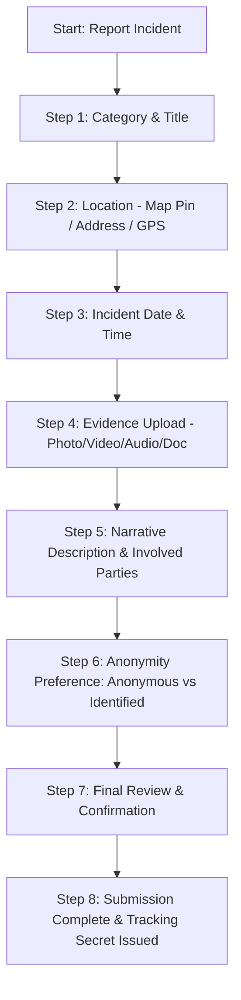
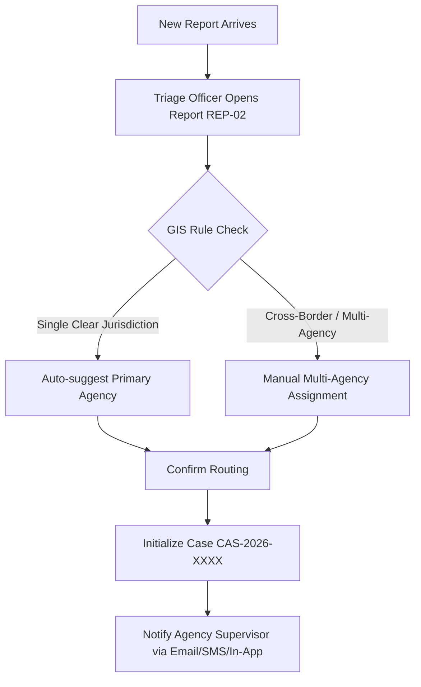
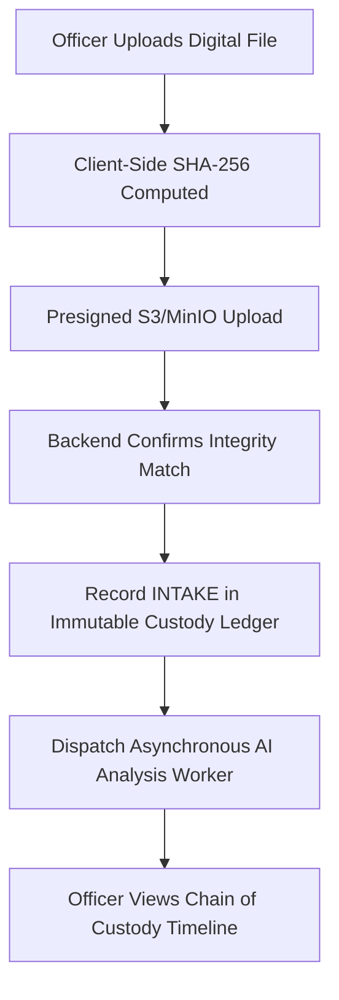

# Critical User Flows

---

## 1. Flow A: Citizen Incident Intake (The 8-Step Wizard)

---

## 2. Flow B: Case Triage & Jurisdiction Routing

---

## 3. Flow C: Evidence Intake & Custodial Transfer

